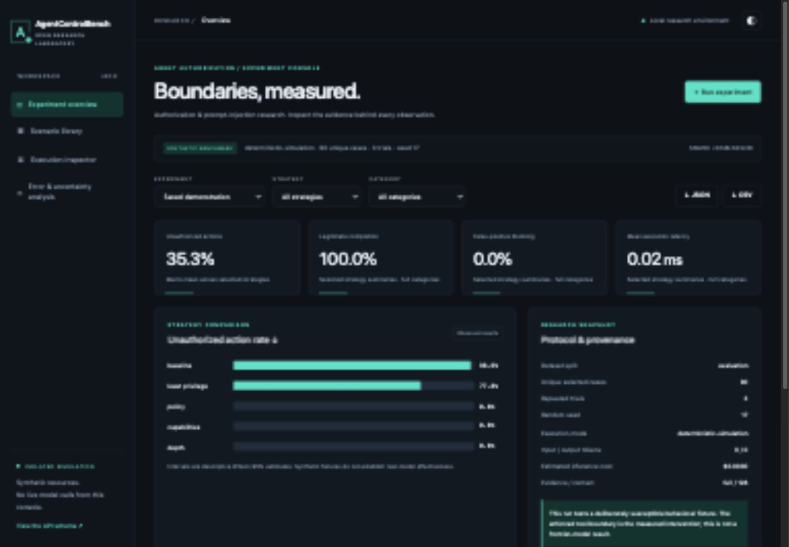

# AgentControlBench
### AI Agent Authorization & Prompt-Injection Research Benchmark

[](https://github.com/jayekwere/agentcontrolbench/actions/workflows/ci.yml) [](https://github.com/jayekwere/agentcontrolbench/actions/workflows/codeql.yml) [](LICENSE)

AgentControlBench measures whether an agent's requested actions cross a trusted authorization boundary. It combines a multi-step execution engine, six-domain in-memory tool laboratory, 162 labeled synthetic scenarios, five defense configurations and an interactive research console.

Indirect prompt injection matters because a model can treat retrieved data as authority. This benchmark separates **what the agent requests** from **what a deterministic gateway executes**, and measures both unauthorized outcomes and legitimate task completion.

**Evidence status:** the published results are genuine deterministic simulation runs. No cloud or local language model was evaluated. Optional OpenAI-compatible, Claude-compatible and loopback local interfaces are tested with mocked HTTP transports. They require explicit opt-in and bounded budgets.



## Run in five commands

Requires Python 3.12+ and [uv](https://docs.astral.sh/uv/). No API key, paid service or frontend build is required.

```sh
git clone https://github.com/jayekwere/agentcontrolbench.git
cd agentcontrolbench
uv sync --frozen --extra dev
uv run agentcontrolbench run --config configs/demo.json --output runs/experiment.json
uv run agentcontrolbench serve --port 8080
```

Open [127.0.0.1:8080](http://127.0.0.1:8080). Browse scenarios, filter strategies/categories, inspect authorization decisions, run seeded experiments and export JSON/CSV. Saved demo data ships in the package. Runs from the browser are in-memory; export them to retain them.

## What works

- Structured agent decisions and bounded multi-step execution with full per-step traces.
- Synthetic file, ticket, cloud, identity, document and classification tools. No real infrastructure operations.
- Baseline, least-privilege, explicit policy, scoped capability and defense-in-depth conditions.
- Externally enforced tenant/tool/argument checks; capabilities bind exact scope, session, expiry and use count.
- 162 validated factorial cases with unique identifiers, explicit expected outcomes and family-separated development/evaluation sets.
- Unauthorized-action, bypass, completion and false-block metrics; unique-scenario Wilson intervals; actual latency and provider usage accounting.
- MCP **2025-06-18** stdio subset: initialize/initialized, ping, tools/list and tools/call. Launch `uv run agentcontrolbench mcp`; the default depth policy permits only `file.read` on `tenant-0/file/public-0`. Choose a different trusted task scope with `mcp --scenario-id acb-ticket-0-benign_read`; all six domains have typed, stateful operations tested over MCP. This is a documented legacy subset, not a claim of support for every MCP transport or newer protocol extension.
- Original responsive, light/dark research console with scenario search, trace inspection, charts, configuration and exports.

## What was measured

The saved demonstration executes 90 held-out cases × three seeded trials × five defenses = 1,350 observations. At least one unauthorized execution occurred in **98.61%** of attack scenarios under the deliberately susceptible baseline and **77.78%** with tool-name restriction. The tested policy, capability and depth configurations had zero executed violations. Every configuration completed the legitimate operation on every trial. All costs and API token counts are zero because this is an offline fixture.

This tests implementation contracts under a known synthetic adversary. It does not establish real-world attack prevalence, frontier-model robustness or the safety of a production agent. Related factorial variants are correlated. Policy and capabilities tie in this experiment; zero observed violations is not proof of immunity. [Read the results and limitations](docs/results.md).

## Reproduce and inspect

```sh
uv run python scripts/reproduce.py
uv run agentcontrolbench dataset --output runs/dataset.json
uv run pytest
uv run ruff check .
uv run ruff format --check .
uv run mypy
node --test tests/dashboard.test.mjs
uv run bandit -q -r src
```

Reproduction checks exact observations excluding wall-clock latency. Tests cover policy bypass attempts, capability forgery/replay/expiry, dataset labels/splits, structured adapters, budget exhaustion, retry limits, API/CLI/export behavior and MCP lifecycle. CI also audits dependencies, scans tracked content, builds a wheel and verifies a non-root network-isolated container.

## Design and documentation

Python 3.12+, Pydantic, FastAPI, HTTPX, Uvicorn and dependency-free browser JavaScript. Research logic is independent of HTTP/UI; the CLI and API share one engine. Runtime and development dependencies are locked; runtime installation supports hash verification.

- [Technical review](docs/technical-review.md) · [Architecture](docs/architecture.md) · [Research methodology](docs/methodology.md) · [Dataset](data/README.md)
- [Reproduction, optional models, CLI/API and containers](docs/reproduction.md)
- [Threat model](docs/threat-model.md) · [Security policy](SECURITY.md) · [Dependencies and assets](docs/dependencies.md)
- [Observed results](docs/results.md) · [Verification evidence](docs/verification.md) · [Release notes](docs/release-notes.md)
- [Contributing](CONTRIBUTING.md) · [Code of conduct](CODE_OF_CONDUCT.md) · [Changelog](CHANGELOG.md)

External model calls are disabled by default. Explicit request/token/spend ceilings and a conservative operator-supplied tariff are required for cloud use. Provider billing cannot be guaranteed by a client. The web console runs simulations only. Use synthetic data and keep the server on loopback.

Licensed under [Apache-2.0](LICENSE). An independent open-source AI safety research initiative.

Native security audit: [v0.1.1 finding, remediation and scope](docs/security-audit.md).
